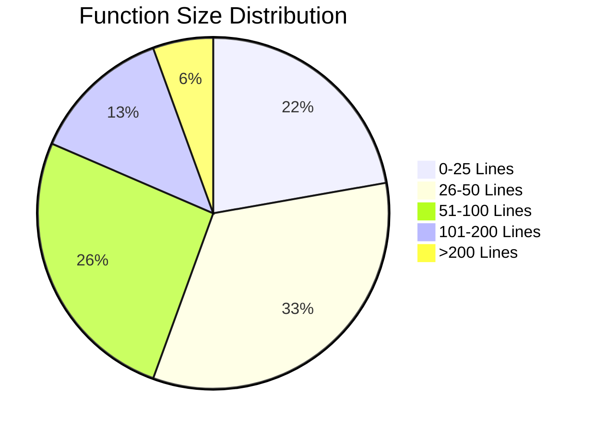
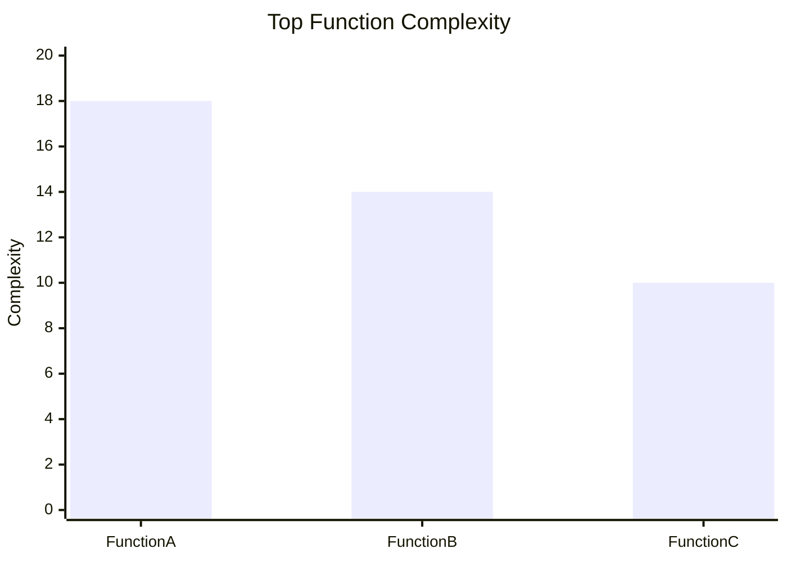
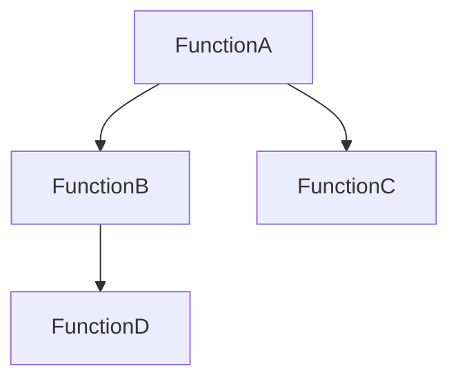

# PSModuleQuantityAnalyzer


[](https://deepwiki.com/HerrHozi/PSModuleQuantityAnalyzer)


```Text
Author:          Holger Zimmermann | zimmermann.holger@live.de
Current Version: 2026.11.26.1356
Last Update:     2026-11-26
```

PSModuleQuantityAnalyzer is a pure PowerShell module for the static analysis of
PowerShell modules. It parses the source files with the PowerShell AST and returns
quantitative metrics about the structure, size, complexity, documentation and
architecture of a module - including its nested modules - and exports the results as
Markdown or CSV reports.

## Project Information

- Author: Holger Zimmermann
- Project: [https://github.com/HerrHozi/PSModuleQuantityAnalyzer](https://github.com/HerrHozi/PSModuleQuantityAnalyzer)
- Blog: [https://herrhozi.com](https://herrhozi.com/)
- License: MIT

## What PSModuleQuantityAnalyzer Does

PSModuleQuantityAnalyzer currently provides the following capabilities:

- Inventory all functions of a module: public or private, source file, lines of code, comment lines, help topics and reference count.
- Report size and code metrics: total lines, comment ratio, average function size and the largest functions.
- Calculate cyclomatic complexity per function and flag refactoring candidates.
- Build the function dependency graph and find unused private functions and duplicate function names.
- Measure the documentation coverage (comment-based help).
- Analyze external module dependencies (manifest, code and transitive) with a version compatibility check.
- List the verbs used by the functions of a module.
- Split the metrics by nested module (`NestedModules`) and show calls between the main module and its nested modules.
- Export the results as Markdown or CSV report.

## Module Structure

- `Public/`: exported PowerShell commands
- `Private/`: internal helper functions (AST cache, reference map, line counting, console output)
- `Assets/`: logo and color palette
- `Example/`: sample Markdown report created with `Export-PSModuleMarkdownReport`
- `ChangeLog.md`: version history

## Requirements

- Windows PowerShell 5.1 or PowerShell 7+
- Dependencies of the analyzed module do not need to be installed

No additional runtimes or packages are required. The module only reads the source files; it does not execute the analyzed code.

## Installation

### Import from a local clone

```powershell
Import-Module .\PSModuleQuantityAnalyzer.psd1 -Force
```

### Install from PowerShell Gallery

```powershell
Install-Module -Name PSModuleQuantityAnalyzer -Scope CurrentUser -Force
Import-Module PSModuleQuantityAnalyzer -Force
```

## Quick Start

All commands take `-ModuleName`: the name of an installed module or the path to a module manifest (`.psd1`).

### Get a summary of a module

```powershell
Get-PSModuleSummary -ModuleName .\MyModule.psd1
Get-PSModuleSummary -ModuleName PSModuleQuantityAnalyzer | Select-Object Version, Function, HelpTopics, TotalLines, LinesOfCode, LinesOfComment, References, PartOfFile | Format-Table
```

Besides returning the object, `Get-PSModuleSummary` appends each result as one row to `%LOCALAPPDATA%\Get-PSModuleSummary.csv`. The file builds up a history of analyses (first column `DateOfAnalysis`) that can be evaluated later with `Import-Csv`, Excel or Power BI.

### Inventory all functions

```powershell
Get-PSModuleQuantity -ModuleName PSModuleQuantityAnalyzer | Format-Table Function, NestedModule, Type, TotalLines, References, PartOfFile
```

`Get-PSModuleQuantity` is the base for most other commands. Each function carries `NestedModule` (`(main)` for the module itself) and `Type` (`Public` when its file is located in a `Public` folder).

### Show metrics and health

```powershell
Get-PSModuleMetrics -ModuleName PSModuleQuantityAnalyzer
Get-PSModuleHealth -ModuleName PSModuleQuantityAnalyzer -LargeFunctionThreshold 100
Get-PSModuleLargestFunctions -ModuleName PSModuleQuantityAnalyzer -Top 5
Get-PSModuleDocumentationCoverage -ModuleName PSModuleQuantityAnalyzer
```

`-LargeFunctionThreshold` sets the line count above which a function counts as large.

### Find complexity and refactoring candidates

```powershell
Get-PSModuleComplexity -ModuleName PSModuleQuantityAnalyzer | Sort-Object Complexity -Descending | Select-Object -First 10
Get-PSModuleRefactoringCandidates -ModuleName PSModuleQuantityAnalyzer -MaxLines 150 -MaxComplexity 10
```

A function is flagged as `LargeFunction` above `-MaxLines` and as `HighComplexity` above `-MaxComplexity`.

### Find dead and duplicate code

```powershell
Get-PSModuleUnusedPrivateFunctions -ModuleName PSModuleQuantityAnalyzer | Select-Object Function, TotalLines, ModificationDate, PartOfFile | Format-Table
Get-PSModuleDuplicateFunctions -ModuleName PSModuleQuantityAnalyzer | Select-Object Function, TotalLines, DuplicateCount, PartOfFile | Format-Table
```

### Show the function dependency graph

```powershell
Get-PSModuleDependencyGraph -ModuleName PSModuleQuantityAnalyzer | Format-Table Function, Calls, File
```

### Analyze external module dependencies

```powershell
Get-PSModuleDependencies -ModuleName .\MyModule.psd1
Get-PSModuleDependencies -ModuleName .\MyModule.psd1 -IncludeTransitiveDependencies -CheckVersionCompatibility -OutputFormat Json
```

Explicit (manifest), implicit (code) and - with `-IncludeTransitiveDependencies` - transitive dependencies are returned. `-IncludeTransitiveDependencies` and `-CheckVersionCompatibility` query the PowerShell Gallery and need internet access.

### Show the verbs used by a module

```powershell
Get-PSModuleUsedVerbs -ModuleName .\MyModule.psd1 | Select-object Verb, Count, Approved | Sort-Object Verb
```

### Analyze nested modules

```powershell
Get-PSModuleNestedModules -ModuleName .\SSAwBH.psd1 | Format-Table NestedModule, Version, Functions, Public, Private, Files, TotalLines, LinesOfCode, CommentRatio
Get-PSModuleNestedDependencies -ModuleName .\SSAwBH.psd1 | Group-Object FromModule, ToModule
Get-PSModuleQuantity -ModuleName .\SSAwBH.psd1 | Group-Object NestedModule
```

`Get-PSModuleNestedModules` reads the `NestedModules` entries of the manifest and returns one row per nested module plus one for the main module. Only nested modules in a sub folder of the module are listed separately; nested modules placed directly in the module folder count as part of the main module.

`Get-PSModuleNestedDependencies` returns every call from a function in one module to a function in another module of the same manifest (`FromModule`, `Calls`, `ToModule`). No calls from a nested module back to the main module means that the nested module could be published separately.

### Export a report

```powershell
Export-PSModuleMarkdownReport -ModuleName PSModuleQuantityAnalyzer
Export-PSModuleMarkdownReport -ModuleName PSModuleQuantityAnalyzer -Path .\Report.md
Export-PSModuleQuantityReport -ModuleName PSModuleQuantityAnalyzer -Path .\ModuleAnalysis.csv
```

Without `-Path`, the Markdown report is written to `ModuleAnalysis_<ModuleName>_<Version>.md` and the CSV report to `ModuleAnalysis.csv` in the current directory. A sample report is available in [Example](Example/ModuleAnalysis_PSModuleQuantityAnalyzer_2026.3.13.420.md).

### Create a checkpoint (backup and new version)

```powershell
$env:PSModuleQuantityAnalyzer = 'C:\GitHub\PSModuleQuantityAnalyzer'
Checkpoint-PSModuleVersion -Module PSModuleQuantityAnalyzer -Commit 'My change' -WhatIf
```

Unlike the other commands, `Checkpoint-PSModuleVersion` takes `-Module` and needs the project root in an environment variable named like the module (it contains the `Dev`, `Backup`, `Release` and `Archive` folders). Remove `-WhatIf` to create the backup, update the version and write the commit. See the [guide](Docs/Checkpoint-PSModuleVersion.md) for branches, push, releases and rollback.

## Example Output

### Module Metrics

| Metric | Value |
|------|------|
| Total Functions | 54 |
| Public Functions | 12 |
| Private Functions | 42 |
| Total Lines | 4820 |
| Lines of Code | 3412 |
| Comment Lines | 604 |
| Comment Ratio | 12.5 % |
| Average Function Size | 89 |

### Function Inventory

| Function | Help Topics | Total Lines | Code | Comments | References | File |
|---|---|---|---|---|---|---|
| Access-Directory | 0 | 34 | 25 | 3 | 1 | Access-Directory.ps1 |
| Add-ADCSForAS2Go | 6 | 44 | 26 | 7 | 1 | Add-ADCSForAS2Go.ps1 |
| Add-GPOMemberToBuiltinGroups | 3 | 142 | 81 | 21 | 1 | Add-GPOMemberToBuiltinGroups.ps1 |
| Add-GPOScheduleTask | 6 | 86 | 47 | 11 | 1 | Add-GPOScheduleTask.ps1 |
| Add-GPOUserRightAssignments | 0 | 164 | 117 | 11 | 1 | Add-GPOUserRightAssignments.ps1 |
| Add-GroupElementToFileGroupsXml | 3 | 55 | 35 | 8 | 0 | Add-GroupElementToFileGroupsXml.ps1 |
| Add-Node | 0 | 28 | 27 | 0 | 7 | ChooseADOrganizationalUnit.ps1 |

### Function Size Distribution



### Complexity Ranking



### Function Dependency Graph



## Public Commands

A guide for every command is available in [Docs](Docs/README.md).

The module currently exports the following commands:

| Command | Alias | Description |
|---|---|---|
| Checkpoint-PSModuleVersion | Module, SourceFolder, BackupFolder, ReleaseFolder, ArchiveFolder, NewBranch, Push, NewRelease, Commit, Rollback, ResetBranch, OrganizeBackups | Back up a module working tree, bump its version and optionally commit, push or release it. |
| Export-PSModuleMarkdownReport | None | Export a comprehensive Markdown analysis report for a module. |
| Export-PSModuleQuantityReport | None | Export the function-level quantity data of a module to a CSV file. |
| Get-PSModuleComplexity | None | Calculate the cyclomatic complexity of each function. |
| Get-PSModuleDependencies | None | Analyze explicit, implicit and transitive module dependencies with an optional version compatibility check. |
| Get-PSModuleDependencyGraph | None | Return caller-to-callee relationships between the functions of a module. |
| Get-PSModuleDocumentationCoverage | None | Calculate how many functions provide comment-based help. |
| Get-PSModuleDuplicateFunctions | None | Detect function names that are defined more than once. |
| Get-PSModuleHealth | None | Return a health summary with large, undocumented and most-referenced functions. |
| Get-PSModuleLargestFunctions | None | Return the largest functions by line count. |
| Get-PSModuleMetrics | None | Return aggregated size, quality and documentation metrics. |
| Get-PSModuleNestedDependencies | None | Return function calls between the main module and its nested modules. |
| Get-PSModuleNestedModules | None | Return version, function counts and line metrics for the main module and each nested module. |
| Get-PSModuleQuantity | None | Return function-level metrics (lines, references, file, nested module) for all functions. |
| Get-PSModuleRefactoringCandidates | None | Flag functions that are too large or too complex. |
| Get-PSModuleSummary | None | Return a high-level summary of a module. |
| Get-PSModuleUnusedPrivateFunctions | None | Return private functions that are not referenced. |
| Get-PSModuleUsedVerbs | None | Return the verbs used by the functions of a module with their count. |

Use `Get-Help` for detailed command documentation:

```powershell
Get-Help Get-PSModuleQuantity -Full
Get-Help Get-PSModuleNestedModules -Full
Get-Help Get-PSModuleNestedDependencies -Full
Get-Help Export-PSModuleMarkdownReport -Full
```

## Typical Workflows

1. Import the module.
2. Get an overview with `Get-PSModuleSummary` or `Get-PSModuleHealth`.
3. Find problem areas with `Get-PSModuleLargestFunctions`, `Get-PSModuleComplexity` and `Get-PSModuleRefactoringCandidates`.
4. Clean up with `Get-PSModuleUnusedPrivateFunctions` and `Get-PSModuleDuplicateFunctions`.
5. Improve the help with `Get-PSModuleDocumentationCoverage`.
6. For modules with nested modules, compare them with `Get-PSModuleNestedModules` and check the coupling with `Get-PSModuleNestedDependencies`.
7. Check external dependencies with `Get-PSModuleDependencies` before publishing.
8. Export the results with `Export-PSModuleMarkdownReport` or `Export-PSModuleQuantityReport`.

## Use Cases

- Prepare modules for PowerShell Gallery publication
- Understand large legacy PowerShell modules
- Detect dead code
- Improve documentation coverage
- Identify refactoring candidates
- Visualize the module architecture
- Decide whether a nested module can be published separately

## Output and Reports

The analysis commands return PowerShell objects, so the results can be filtered, sorted and exported with the standard cmdlets (`Where-Object`, `Sort-Object`, `Export-Csv`, `ConvertTo-Json`).

- `Export-PSModuleMarkdownReport` writes a GitHub-friendly Markdown report including Mermaid diagrams.
- `Export-PSModuleQuantityReport` writes the function-level data to a CSV file.
- The module writes its own log file `PSModuleQuantityAnalyzer.log` into the module folder.

## Recommended Safety Practices

- The analyzed module is only parsed, never executed. Still, review reports before sharing them - function names, file names and paths can reveal internal details.
- `Get-PSModuleDependencies` queries the PowerShell Gallery when `-IncludeTransitiveDependencies` or `-CheckVersionCompatibility` is used.
- Do not commit secrets such as API keys into the analyzed source files or into the generated reports.
- Keep reports under version control to track the module quality over time.

## Roadmap

- Code quality score
- Maintainability index
- Architecture visualizations
- CI/CD integration

## Contributing

Issues and pull requests are welcome.

If you contribute changes, please include:

- Reproduction steps
- Expected and actual behavior
- The analyzed module (or a sanitized sample) where useful

## Acknowledgments

Thanks to the PowerShell community and the open-source projects that document the PowerShell language and AST.   
